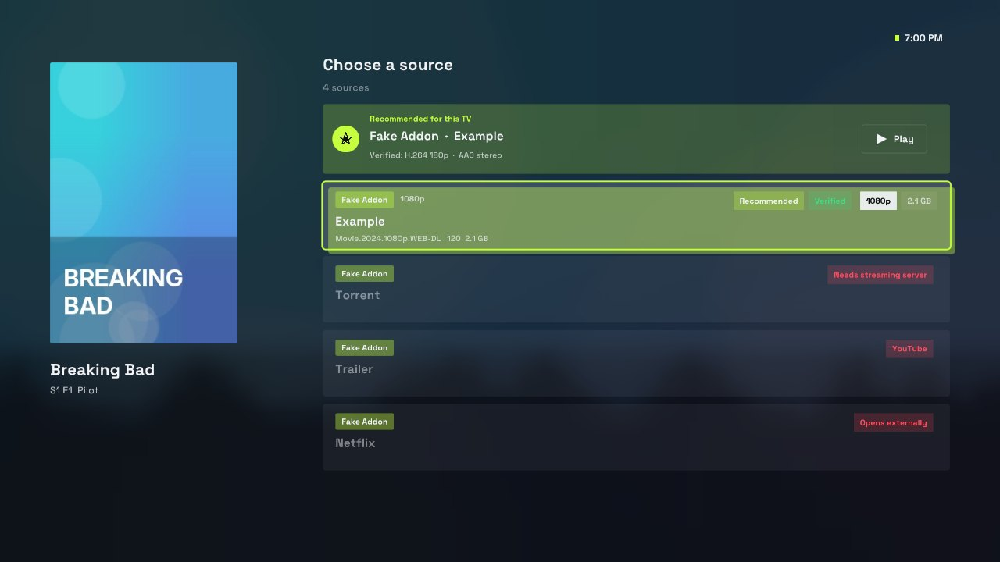
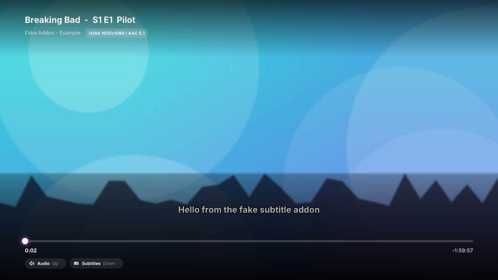
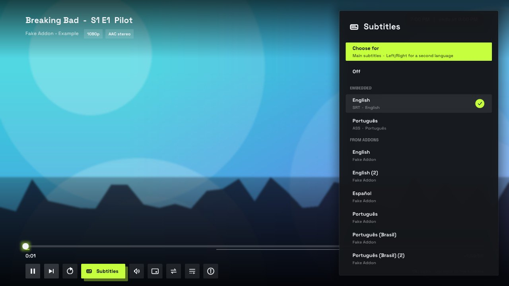
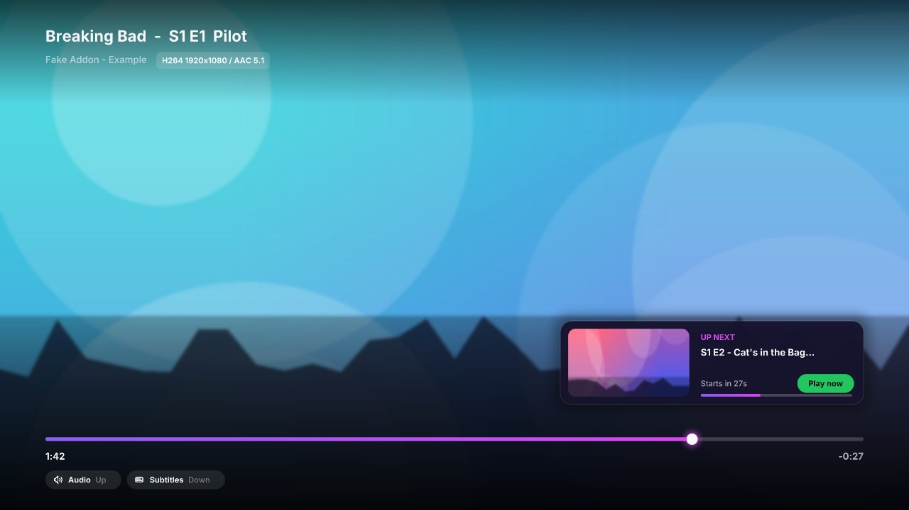

# Stremio Native TV (unofficial)

A native Stremio client for TVs that the official web app cannot run on well:
LG webOS 3+, Samsung Tizen 4+ (native `.tpk`) and Tizen 5.5+ (WebAssembly `.wgt`).
Written in C99 on SDL2 + OpenGL ES 2, with the TV's own video pipeline doing playback.

It is modelled on [nuvio-native-legacy](https://github.com/iqui27/nuvio-native-legacy),
which proved the approach for Nuvio. This project does the same for the
**Stremio addon protocol** and the **Stremio account API**, so it uses the same
account, addons, Library and Continue Watching as the official apps.

> Status: **v0.4.0**. The desktop preview builds warning-free, passes its unit tests and
> runs every screen headlessly against a fake addon (including subtitles, the track menu,
> source fallback and Up Next). The webOS and Tizen video backends follow the platform
> APIs and the webosbrew SDL headers but have **not yet been compiled with the TV
> toolchains or run on a TV**. See *What is verified* below before trusting anything.

## Screenshots

Captured headlessly from the desktop build against the test addon (generated
artwork, not real titles). On a TV the player shows video where these show the
backdrop.

| Home | Detail + episodes |
|---|---|
|  |  |
| **Sources** | **Player + subtitles** |
|  |  |
| **Track panel** | **Up Next** |
|  |  |
| **Sign in with a QR code** | **Settings** |
|  |  |

## Design

- **Renderer**: a single batched GLES2 stream. Rounded rects, rings, soft shadows,
  capsule lines and the play triangle are signed-distance shapes whose parameters
  ride in the vertex format, so they batch with text and textures. Only a texture
  or clip change splits a draw call.
- **Ambient light**: the dominant colour of the focused artwork tints large soft
  glows behind every screen and eases as focus moves.
- **Motion**: half-life easing for scrolling, focus growth, hero cross-fades and
  toasts; all of it switches off in *Light* effects, which *Automatic* picks on
  slow TVs.
- **Type**: Inter Medium and Bold, packed into two 2048² alpha atlases at start-up.

## What it does

- **Addon protocol**: manifests (string and object resources, `idPrefixes`, modern `extra`
  and legacy `extraSupported`), catalogs with extras (`search`, `skip`, `genre`), meta,
  streams, subtitles. URL building and response parsing are unit-tested.
- **Account**: `login`, `logout`, `addonCollectionGet/Set`, `datastoreGet/Put` for
  `libraryItem`. Progress is written with the same `state` fields as stremio-core, so
  Continue Watching stays in sync with phones and desktops.
- **Logged out**: Cinemeta + OpenSubtitles defaults, plus addons installed from a URL.
- **Screens**: Home (hero, Continue Watching, one row per catalog), Detail (seasons and
  episodes, resume, add to Library), Streams (all stream addons, badges for torrent /
  YouTube / external), Player overlay, Search (debounced, every catalog with a `search`
  extra), Settings (account, streaming server, install/remove addons), Sign in with an
  on-screen keyboard.
- **Playback**: audio / subtitle track menu, addon subtitles (SRT, VTT) with timing
  offset, preferred languages, automatic fallback to the next source when the pipeline
  fails or stalls, Up Next with autoplay on the same release, coalesced seeking,
  buffering readout, background/foreground handling.
- **Sign-in by QR** or short code via link.stremio.com; e-mail + password as fallback.
- **Snappy on old hardware**: keep-alive HTTP, disk caches for artwork and catalogs
  (Home opens from cache instantly), poster prefetch and fade-in, eased scrolling,
  cross-faded backdrops, idle frame skipping, and an Automatic effects level that
  measures the TV and drops to Light when it cannot keep up. Artwork budget follows RAM.
- **Spoiler blur** on unwatched episode thumbnails (mipmap bias, no extra shader pass).
- **libcurl via `dlopen`**: never linked, because LG ships `libcurl.so.5` and the SDK
  ships `.so.4`.

Taken from the Nuvio port on purpose: cache-first Home, Automatic/Full/Light effects,
spoiler blur, QR sign-in, seek-shows-only-the-bar, RAM-based texture budget, the
exported-window / ACB split, dlopen'd curl, the log file. Left out on purpose because
they would make the client less stable right now: the in-app updater, the DTS-to-AAC
FFmpeg transcoder, libass for embedded ASS, YouTube/Apple trailers in the hero, the
Samsung .NET host for 2018-2020 sets, Trakt/Simkl/debrid integrations (those live in
Stremio addons anyway), and the JavaScript plugin engine. See `docs/ROADMAP.md`.

## Layout

```
src/
  main.c               SDL/GL setup, main loop, dev hooks (SNTV_SCREENSHOT, SNTV_KEYS)
  app.c/.h             app state: addons, library, auth, screen stack, progress sync
  http.c/.h            libcurl over dlopen + worker pool; callbacks on the main thread
  store.c/.h           settings.json + cached JSON in the app's writable dir
  image.c/.h           async artwork loader with LRU byte budget
  log.c/.h             log file (stdout is /dev/null under SAM on webOS)
  subs.c/.h            SRT / WebVTT parser and cue lookup
  addon/addon.c        Stremio addon protocol: manifest, catalog/meta/stream/subtitles
  addon/stremio_api.c  api.strem.io requests/responses, LibraryItem (de)serialisation
  ui/gfx.c             batched GLES2 renderer: SDF rounded rects, rings, shadows, lines, video hole
  ui/font.c            two-face stb_truetype atlases (Inter), UTF-8, ellipsis, wrap, shadowed text
  ui/widgets.c         design kit: icons, pills, chips, toggles, cards, skeletons, backdrops, ambient light
  ui/input.c           keyboard + LG/Samsung remote mapping
  ui/keyboard.c        d-pad on-screen keyboard
  ui/screen_*.c        home, detail, streams, player, login, search, settings
  video/video.h        backend interface
  video/video_null.c   desktop preview (simulated clock)
  video/video_webos.c  com.webos.media over LS2; exported window (webOS 5+) or ACB (2-4)
  video/video_tizen.c  capi-media-player, overlay display
  video/video_wasm.c   HTML5 <video> behind a transparent canvas (Tizen .wgt)
deploy/webos           appinfo.json, icons (type: native)
deploy/tizen-native    tizen-manifest.xml
deploy/tizen-wasm      config.xml + index.html
tools/                 linux.sh, webos.sh (+ --ipk/--install), package-ipk.sh,
                       tizen-native.sh, tizen-wasm.sh, env.sh
tests/                 test_addon.c (protocol/API unit tests), fake_addon.py, smoke.sh
vendor/                cJSON (MIT), qrcodegen (MIT), stb_truetype, stb_image (public domain)
assets/fonts/          Inter Medium + Bold (SIL Open Font License, see Inter-LICENSE.txt)
```

## Install on an LG TV

You need the [Homebrew Channel](https://github.com/webosbrew/webos-homebrew-channel)
on the TV (it works without root). Then, on the TV:

1. Open **Homebrew Channel**, then **Settings**.
2. Add this repository URL:

   ```
   https://github.com/smalik29871/stremio-native-tv/releases/latest/download/repo.json
   ```
3. Go back to the app list and install **Stremio (native)**. Updates show up there too.

Or download the `.ipk` from the [latest release](https://github.com/smalik29871/stremio-native-tv/releases/latest)
and install it with Developer Mode (`ares-install`) or Dev Manager.

**The one open question is video on TVs without root.** The app talks to the
TV's media service directly. That is confirmed for native apps on rooted TVs,
but whether a Homebrew Channel install on a non-rooted TV gets the same bus
permission has not been measured (the Nuvio project documents the same caveat).
If the interface works but video is black, send `app.log` from the app's data
folder; it records every reply from the media service.

## Releasing

Bump `version` in `deploy/webos/appinfo.json` (and `SNTV_APP_VERSION` in
`src/platform/platform.h`), add a `## x.y.z` section to `CHANGELOG.md`, and push to
`main`. CI builds and checks the package and, because that version has no release
yet, publishes it with the Homebrew Channel files. TVs pick it up from the channel.

## Building

### Desktop preview (Linux, no video)
```
sudo apt install cmake build-essential libsdl2-dev libgles-dev
tools/linux.sh            # builds, runs unit tests
./build/stremio-tv        # arrows / Enter / Esc, F3 = search, F1/F2/F4 = colour keys
```
Headless UI check (needs Xvfb + Pillow): `bash tests/smoke.sh` writes screenshots to `tests/out/`.

### LG webOS (.ipk)
1. Get the toolchain: `arm-webos-linux-gnueabi_sdk-buildroot-x86_64.tar.gz` from
   [openlgtv/buildroot-nc4 releases](https://github.com/openlgtv/buildroot-nc4/releases)
   (macOS builds: [webosbrew/native-toolchain](https://github.com/webosbrew/native-toolchain)).
   Extract it and run `relocate-sdk.sh`. It ships SDL2 (the webOS fork), GLES2, luna-service2.
2. `WEBOS_TOOLCHAIN=/path/to/arm-webos-linux-gnueabi_sdk-buildroot tools/webos.sh --ipk`
3. Install with the Homebrew Channel / Dev Manager, or `TV_IP=... tools/webos.sh --install` on a rooted TV.

`tools/package-ipk.sh` uses `ares-package` when present and otherwise writes the
`ar` + tar layout itself, and refuses to package anything that looks like a credential file.

### Samsung Tizen native (.tpk, Tizen 4.0-9)
Tizen Studio with the TV native rootstrap: `tools/tizen-native.sh`. The package is left
unsigned on purpose; sign with your certificate profile (`TIZEN_SIGN_PROFILE=...`) or let
Apps2Samsung sign it for the TV's DUID. 2018-2020 sets block native code in the app
folder; the Nuvio project works around that with a .NET host that loads the library from
memory. That shim is **not** part of this repository yet.

### Samsung Tizen WebAssembly (.wgt, Tizen 5.5+)
Emscripten: `EMSDK=~/emsdk tools/tizen-wasm.sh`. Networking must go through the browser
in this build; `src/http.c` is still the curl implementation, so a `fetch()`-based
`http_wasm.c` is the first thing to add before the `.wgt` is useful (see roadmap).

## What is verified, and what is not

| Area | Status |
|---|---|
| Addon protocol + API parsing, link login, subtitles | Unit tests pass (`tests/test_addon.c`, `tests/test_subs.c`) |
| Full UI flow incl. track menu, addon subtitle rendering, Up Next card and autoplay, QR screen | Smoke-tested headless under Xvfb against `tests/fake_addon.py` (14 scripted runs, screenshots in `tests/out/`) |
| Live `api.strem.io` / Cinemeta | Not reachable from the build sandbox; untested live |
| webOS build | Cross-compiled in CI with the openlgtv toolchain; package checked (ARM, dependencies, glibc 2.7, contents) |
| webOS playback (LS2 payloads, exported window, ACB binding) | Follows what the Nuvio native client documents from real TVs; **not yet run on a TV from this repo** |
| Tizen native player | Written against capi-media-player; **needs Tizen Studio + TV** |
| Remote scancodes | Match LG's `SDL_webOS.h` in the webOS SDK (Back 482, Exit 505, colours 486-489) |
| Live `link.stremio.com` QR flow | Endpoint shapes from stremio-core; unreachable from the sandbox, untested live |

Things known from the Nuvio port that are already handled: `SDL_WEBOS_ACCESS_POLICY_KEYS_BACK`
is set before the window is created; logs go to a file; libcurl is `dlopen`ed trying
`.so.5` then `.so.4`; the GL surface keeps an 8-bit alpha channel and the player punches a
transparent hole so the video plane shows through; the UI is laid out on a 1920x1080
canvas and scaled, so 720p webOS 3 panels work.

## Player keys

OK play/pause, Left/Right seek 10 s (accelerates while held), Up audio menu, Down
subtitle menu (Left/Right inside it shifts timing by 0.5 s), Green play Up Next now,
Yellow switch to the next source, Back stop and save progress.

## Torrent streams

Stremio's torrent engine (`server.js`) is not available on TVs. Streams that only carry an
`infoHash` are shown with a *needs server* badge until you set a **Streaming server** URL
in Settings (any machine on your LAN running the Stremio service, usually port 11470).
Debrid addons return plain HTTPS URLs and work without it.

## Configuration and data

Everything lives in the app's writable directory (`SDL_GetPrefPath`, falling back to
`$HOME/.org.stremio.nativetv`): `settings.json` (auth key, streaming server, local addon
list, resume points), `addons.json` and `library.json` caches, `app.log` and `app.prev.log`.
No credentials are compiled into the binary.

## License

No licence file is committed yet; pick one before publishing. The reference project is
GPL-3.0 and stremio-web is GPL-2.0, so a GPL licence is the natural fit. Vendored
code: cJSON (MIT), qrcodegen (MIT), stb (public domain / MIT). Font: Inter (SIL Open
Font License 1.1, see `assets/fonts/Inter-LICENSE.txt`).
